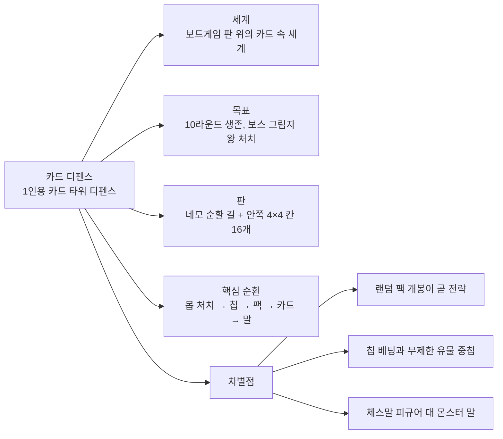
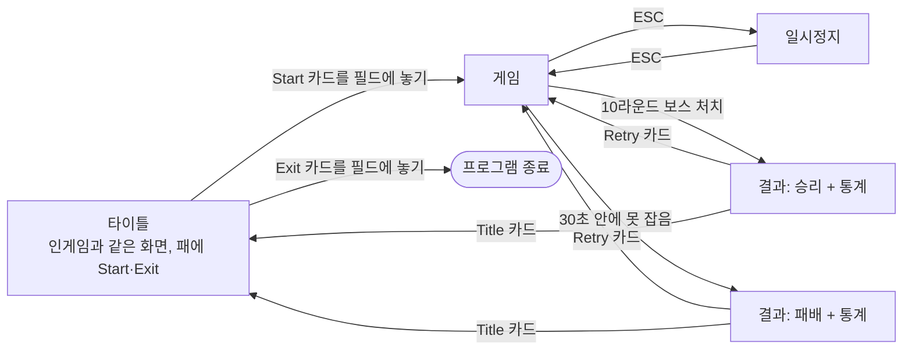
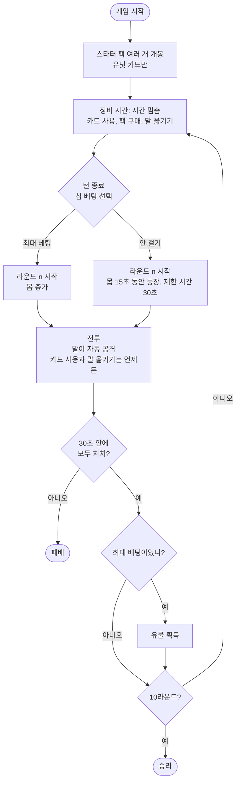
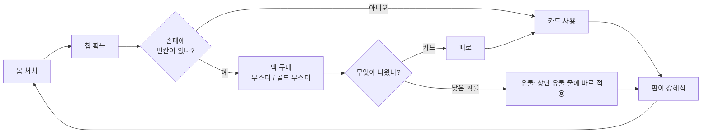
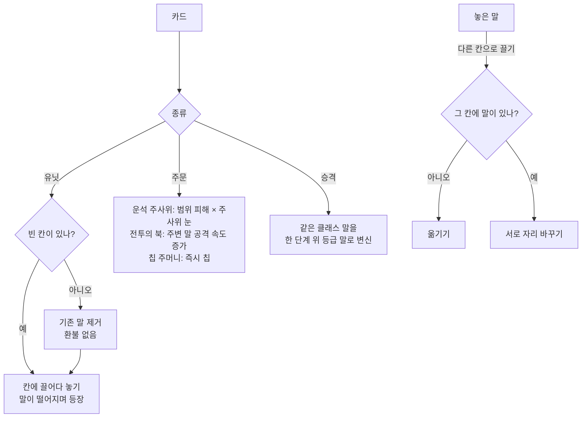
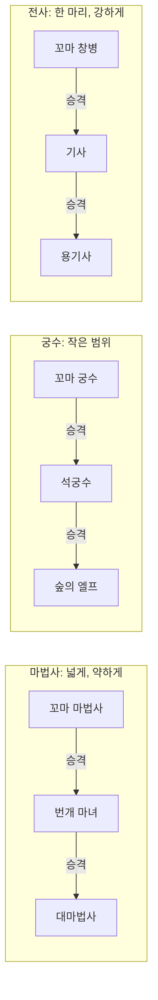

# 카드 디펜스 플로우차트

기준: `카드디펜스-제안서.md` (2026-10-22). 다이어그램은 Mermaid 문법이다.

## 1. 이 게임은 무엇인가

## 2. 화면 흐름

## 3. 한 판의 흐름

- 10라운드에는 보스 그림자 왕이 나온다. 보스도 30초 안에 잡아야 한다.

## 4. 핵심 순환

- 손패는 최대 6장이다. 빈칸이 없으면 카드를 써서 자리를 만들어야 팩을 살 수 있다.

## 5. 카드를 쓸 때와 말을 옮길 때

유물은 카드가 아니므로 여기에 없다. 팩에서 낮은 확률로 나오거나 최대 베팅 클리어 보상으로 얻고, 패를 거치지 않고 바로 적용된다.

## 6. 말의 성장

- 왼쪽부터 일반 → 희귀 → 영웅. 등급이 높을수록 사거리가 길어 가운데 칸에서도 길에 닿는다.
